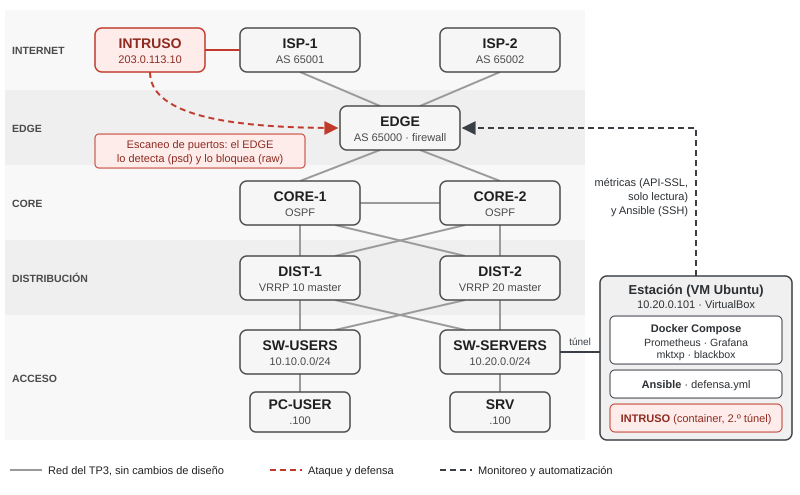

# Sistema Inmune: la red que se cura y se defiende sola

> **TP4 Integrador · Modalidad A (Proyecto de Desarrollo)** · Gestión Operativa y Seguridad en Redes (GOYS) · UTN Facultad Regional La Plata
> **Grupo 11:** Lautaro Aubert · Juan Bautista Cuenca · Tomás Martin · Santiago Natalichio Bestosini

La red empresarial del [TP3](https://github.com/LauAubert/goys-failover-grupo11), con siete routers MikroTik, ya se recuperaba sola de la caída de un gateway, de un enlace o de un proveedor. Este proyecto le agrega lo que le faltaba: un **tablero en tiempo real con alertas**, para que alguien se entere de una falla mientras pasa, y una **defensa en el router de borde** que reconoce un escaneo de puertos y bloquea al atacante sin intervención humana, desplegada con **Ansible**.

La idea que ordena el diseño es la de un sistema inmune: la red cicatriza (VRRP, OSPF y BGP del TP3), siente dónde le duele (Prometheus y Grafana) y neutraliza al intruso (detección y bloqueo en el EDGE).



---

## Resultados

| Qué se midió | Resultado |
|---|---|
| Corte de un enlace interno, visto en el tablero | La red vuelve en ~1 s (laboratorio de H3) a ~10 s (laptop de la feria) |
| Caída de un proveedor | `DestinoInalcanzable` avisa en 2 s; la sesión BGP recién cae a los ~3 min ([D-15](decisiones.md#d-15)) |
| Escaneo de puertos (nmap, 100 puertos) | **Bloqueado entre 0,08 y 2,72 s** después de empezar |
| Duración del bloqueo | ~2 minutos (121–130 s; una corrida de 237 s sin causa confirmada) |
| Durante el bloqueo | BGP, OSPF, los hosts y el monitoreo siguen funcionando |
| Escaneo con más de 3 s entre intentos | No se detecta: es el límite de la defensa ([D-18](decisiones.md#d-18)) |

El detalle, con el método de medición y las limitaciones, está en el [documento final](documento/documento-final.pdf).

---

## Entregables

| Entregable | Dónde |
|---|---|
| Documento final (short paper) | [`documento/documento-final.pdf`](documento/documento-final.pdf), fuente en `documento-final.html` (`python documento/generar-pdf.py` lo regenera) |
| Propuesta presentada para la feria | [`documento/propuesta-tp4.pdf`](documento/propuesta-tp4.pdf) y [`propuesta.md`](propuesta.md) |
| Póster A1 | `poster/` (pendiente) |
| Video de respaldo de la demo | Pendiente (H7) |
| Evidencia | [`capturas/`](capturas/), una carpeta por hito, con la firma de quien hizo cada prueba |

---

## Equipo y hitos

Cada hito se trabajó en una rama propia y entró a `main` por un *pull request* revisado por otro integrante ([D-12](decisiones.md#d-12)).

| Hito | Qué se hizo | Responsable | PR |
|---|---|---|:-:|
| H1 · H2 | Copia del laboratorio del TP3 y estación de monitoreo conectada a la red | Santiago | #1 |
| H3 | Tablero y alertas: usuario de solo lectura y API-SSL en los routers; Prometheus, mktxp, blackbox y Grafana | Juan Bautista | #2 |
| H4 | INTRUSO del lado de ISP-1: container con nmap unido a la red por un túnel UDP | Tomás | #3 |
| H5 | Defensa en el EDGE (Santiago) y pruebas y medición desde el INTRUSO (Tomás); corrida completa en la laptop de la feria | Santiago y Tomás | #4 · #6 |
| H6 | Despliegue y retiro de la defensa con Ansible | Lautaro | #5 |
| H7 | Ensayo general y video de respaldo | Todo el grupo | pendiente |

La bitácora con fechas está en [`progreso.md`](progreso.md), y las 20 decisiones técnicas, con contexto, alternativas y evidencia, en [`decisiones.md`](decisiones.md).

---

## Tecnologías

| Pieza | Versión |
|---|---|
| GNS3 (servidor local, sin GNS3 VM) | 2.2.61 |
| MikroTik CHR (RouterOS), 7 routers | 7.21.5 |
| QEMU para Windows | 11.x |
| VirtualBox (estación) | 7.x |
| Ubuntu Server (estación) | 24.04 |
| Prometheus · Grafana · blackbox exporter · mktxp | 3.5.0 · 12.0.0 · 0.27.0 · 1.2.20 |
| Ansible (paquete de Ubuntu, con `community.routeros`) | 9 |
| INTRUSO: Alpine · nmap | 3.20 · 7.95 |

Las imágenes de Docker están fijadas por versión y se descargan de antemano, porque la demo corre sin Internet ([D-08](decisiones.md#d-08)).

---

## Cómo reproducirlo

Sobre una PC con Windows, GNS3, QEMU y VirtualBox, y el proyecto de GNS3 del TP3. Cada paso tiene su *runbook*:

1. **Laboratorio y estación (H1 y H2):** [`demo/runbooks/preparar-estacion.md`](demo/runbooks/preparar-estacion.md). La estación es una VM de VirtualBox unida a GNS3 por un túnel UDP ([D-05](decisiones.md#d-05), [D-06](decisiones.md#d-06)). En una PC con la app de NVIDIA, revisar antes [D-17](decisiones.md#d-17).
2. **Tablero (H3):** aplicar [`demo/routers/H3-monitoreo.rsc`](demo/routers/H3-monitoreo.rsc) en los 5 routers de la empresa; en la estación, completar `demo/.env` (desde [`.env.ejemplo`](demo/.env.ejemplo)) y `demo/mktxp/mktxp.conf` (desde [`mktxp.conf.ejemplo`](demo/mktxp/mktxp.conf.ejemplo)) y correr `docker compose up -d` en `demo/`. Grafana queda en `http://127.0.0.1:3000`.
3. **INTRUSO (H4):** [`demo/runbooks/intruso.md`](demo/runbooks/intruso.md).
4. **Defensa (H5):** [`demo/routers/H5-defensa.rsc`](demo/routers/H5-defensa.rsc) en el EDGE; pruebas y medición en [`demo/runbooks/defensa.md`](demo/runbooks/defensa.md).
5. **Automatización (H6):** [`demo/runbooks/automatizacion.md`](demo/runbooks/automatizacion.md).

**Orden de arranque en cada sesión:** primero GNS3 con todos los nodos (los routers tardan 2 o 3 minutos), después la estación. Al terminar, apagar la estación (`sudo poweroff`) y después los nodos.

---

## Guion de la demo

En la estación, con GNS3 y el tablero de Grafana a la vista:

| # | Paso | Cómo | Qué se ve |
|:-:|---|---|---|
| 1 | Falla | Cortar un enlace o apagar un router en GNS3 | El ping del tablero se corta, salta `DestinoInalcanzable` y la red se recupera sola |
| 2 | Ataque sin defensa | `bash ~/intruso.sh escanear` | nmap termina y el INTRUSO sigue llegando al EDGE |
| 3 | Despliegue | `ansible-playbook defensa.yml --ask-vault-pass` (en `demo/ansible/`) | Ansible aplica la detección y el bloqueo en el EDGE |
| 4 | Ataque con defensa | `bash ~/medir-neutralizacion.sh` | El INTRUSO queda bloqueado en segundos, salta `IntrusoBloqueado` y BGP sigue arriba |
| 5 | Reinicio entre visitantes | `ansible-playbook defensa-quitar.yml --ask-vault-pass` | El EDGE vuelve al estado del paso 1 y se vacía la lista de bloqueados |

---

## Estructura del repositorio

```
├── README.md              # este archivo
├── propuesta.md           # propuesta aprobada para la feria
├── decisiones.md          # registro de decisiones técnicas (D-01 a D-20)
├── progreso.md            # bitácora del grupo
├── documento/             # propuesta y documento final (PDF + fuente HTML)
├── diagramas/             # arquitectura (SVG) y figura de la propuesta
├── capturas/              # evidencia por hito (H1 a H6)
├── demo/
│   ├── docker-compose.yml # stack de monitoreo (Prometheus, Grafana, mktxp, blackbox)
│   ├── prometheus/  grafana/  mktxp/  blackbox/
│   ├── routers/           # cambios por hito para pegar en los routers (.rsc)
│   ├── estacion/          # scripts para crear y preparar la VM estación
│   ├── intruso/           # imagen, red y scripts del INTRUSO (H4) y la medición (H5)
│   ├── ansible/           # playbooks de la defensa (H6)
│   └── runbooks/          # paso a paso de cada hito
├── poster/                # póster A1 (pendiente) y guía de la cátedra
└── templates/             # plantillas y README originales de la cátedra
```

---

## Claves y secretos

Ninguna clave está en el repositorio. Las de los routers (OSPF, BGP, VRRP, `admin`, `monitor` y `prometheus`) viven solo en los routers y en una base de KeePassXC que se comparte por fuera de Git; en los `.rsc` y en los comandos van marcadores como `<CLAVE_MONITOREO_H3>`. Las credenciales del stack de monitoreo van en `demo/.env` y `demo/mktxp/mktxp.conf`, y la clave de Ansible en Ansible Vault; los tres están en `.gitignore`.
